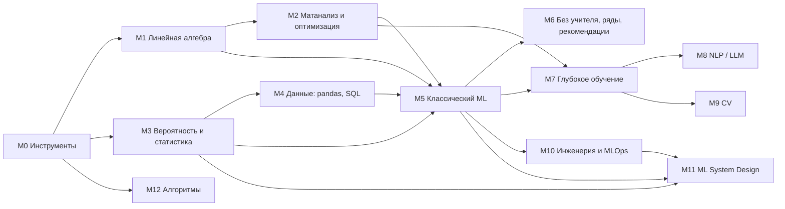

# План обучения ML — вариант A

> [!abstract] Суть варианта A
> **Год 1** — учёба до уровня junior (≈700 ч) и поиск работы с **недели 48**.
> **Год 2** — рост до middle **внутри работы**. Рабочие задачи заменяют проектную практику, а учебный план становится поддерживающим треком на **6–8 ч/нед**.

> [!warning] Почему так
> Middle — это уровень, который подтверждают коммерческим опытом: самостоятельные задачи, прод, работа с бизнесом. Поэтому главная цель первого года — не «знать всё», а **получить первую работу в ML**. Middle вырастает из рабочего опыта плюс целевой доучёбы.

## Навигация

- [[#Легенда и правила]]
- [[#Карта знаний]]
- [[#Пререквизиты]]
- [[#ГОД 1 — до уровня Junior]]
- [[#Трек поиска работы (недели 48–60)]]
- [[#ГОД 2 — рост до Middle внутри работы]]
- [[#Понедельное расписание — Год 1]]
- [[#Расписание — Год 2]]
- [[#Техники обучения]]
- [[#Типичные ошибки]]
- [[#Буферы и ревизии]]
- [[#Метрики прогресса]]
- [[#Журнал недели (шаблон)]]

---

## Легенда и правила

- **Т** — теория (чтение, лекции, видео).
- **П** — практика (код, задачи, проекты; во втором году ещё и рабочие задачи).
- **Р** — активное повторение (Anki, самотесты, техника Фейнмана).
- **[ЯДРО]** / **[ВАЖНО]** / **[ДОП]** — приоритет темы.
- **[проверь]** — я не уверен на 100% в названии, структуре или наличии ресурса. Проверьте перед стартом этапа.
- Правило: **П + Р ≥ 70%** времени.
- Правило: план меняется **только на ревизиях**.
- Правило минимальной недели: в тяжёлую неделю 5–6 часов (Anki + одна задача + Фейнман) **засчитываются как выполненная неделя**.

### Шаблон недели — Год 1 (14 ч)

| День | Часы | Содержание |
|---|---|---|
| Пн | 2 | 10 мин «пустой лист» → 50 мин Т → 45 мин П → 15 мин Anki |
| Вт | 2 | П (задачи, код) → 15 мин Anki |
| Ср | — | Отдых |
| Чт | 2 | 50 мин Т → 55 мин П → 15 мин Anki |
| Пт | 2 | П → 1 ч алгоритмов (с недели 15) |
| Сб | 3 | Смешанная практика или мини-проект |
| Вс | 3 | 2 ч проекта → 40 мин Фейнмана → 20 мин журнала недели |

- При 20 ч/нед добавляйте часы **только в практику**.
- При 10 ч/нед режьте теорию и проект, **Anki и Фейнмана не трогайте**.

---

## Карта знаний



> [!tip] Главный путь
> M1 → M2 → M5 → M7 → M8. Его нельзя перепрыгивать.

### M0. Инструменты
- Python продвинутый: классы, генераторы, typing, исключения [ЯДРО]
- git: ветки, merge, PR [ЯДРО]
- Jupyter, VS Code, uv/venv [ЯДРО]
- Командная строка Linux [ВАЖНО]

### M1. Линейная алгебра
- Векторы, нормы, скалярное произведение, косинусная близость [ЯДРО]
- Матрицы как преобразования, умножение, СЛАУ [ЯДРО]
- Ранг, обратная матрица [ВАЖНО]
- Собственные значения, SVD [ЯДРО]
- Векторизация в numpy [ЯДРО]

### M2. Матанализ и оптимизация
- Производные, градиент [ЯДРО]
- Цепное правило [ЯДРО]
- GD, SGD, momentum [ЯДРО]
- Выпуклость [ВАЖНО]; множители Лагранжа [ДОП]

### M3. Вероятность и статистика
- Распределения, условная вероятность, Байес [ЯДРО]
- Матожидание, дисперсия, корреляция [ЯДРО]
- ЦПТ, доверительные интервалы, бутстрап [ЯДРО]
- Гипотезы, p-value, мощность [ЯДРО]
- A/B-тесты [ВАЖНО]; MLE [ВАЖНО]; байесовская статистика [ДОП]

### M4. Работа с данными
- pandas, SQL с оконными функциями [ЯДРО]
- EDA, визуализация [ЯДРО]
- Пропуски, выбросы, категориальные признаки [ЯДРО]
- Spark [ДОП]

### M5. Классический ML
- Постановки задач, функции потерь [ЯДРО]
- Линейная и логистическая регрессия, регуляризация [ЯДРО]
- Метрики, кросс-валидация, утечки [ЯДРО]
- Деревья, Random Forest, градиентный бустинг [ЯДРО]
- Feature engineering [ЯДРО]
- Optuna, SHAP, несбалансированные классы [ВАЖНО]
- kNN, SVM [ВАЖНО]; калибровка [ДОП]

### M6. Без учителя и специальные задачи
- PCA [ЯДРО]; кластеризация [ВАЖНО]
- Временные ряды [ВАЖНО]; рекомендательные системы [ВАЖНО]
- UMAP, аномалии [ДОП]

### M7. Глубокое обучение
- MLP, backprop, PyTorch [ЯДРО]
- Оптимизаторы, BatchNorm, Dropout, transfer learning [ЯДРО]
- CNN [ВАЖНО]; RNN [ДОП]

### M8. NLP/LLM
- Токенизация, эмбеддинги, attention, трансформеры, Hugging Face [ЯДРО]
- RAG, LoRA, оценка LLM [ВАЖНО]

### M9. Компьютерное зрение — [ДОП], если не специализация

### M10. Инженерия и MLOps
- pytest, чистый код, Docker [ЯДРО]
- FastAPI, MLflow, CI [ВАЖНО]
- Мониторинг, дрифт [ВАЖНО]
- Airflow/Prefect, облака [ДОП]

### M11. ML System Design — [ЯДРО для middle]
### M12. Алгоритмы и структуры данных — [ВАЖНО для собеседований]
### M13. Профессиональные навыки
- Бизнес-метрики, перевод бизнес-задачи в ML-задачу [ЯДРО для middle]
- ML-английский (глоссарий в Anki) [ВАЖНО]

---

## Пререквизиты

> [!tip] Подробно: [[Пререквизиты ML]]
> Самодиагностика, ресурсы, задачи по уровням и маршрут подготовки по каждому навыку.

Самопроверка до старта. Если хотя бы один пункт не выполняется, добавьте неделю на Python.

- [ ] Без подсказок пишу класс с `@dataclass`, генератор, comprehension, обработку исключений, чтение и запись CSV/JSON
- [ ] Умею создать ветку в git, закоммитить, слить и разрешить конфликт
- [ ] Свободно работаю со степенями, логарифмами, графиками функций, знаком Σ
- [ ] Есть аккаунты GitHub и Kaggle (бесплатный GPU ≈30 ч/нед, лимит может меняться)
- [ ] Установлены Anki и VS Code
- [ ] Компьютер с 8+ ГБ RAM; всё тяжёлое считаю на Kaggle или Colab

---

# ГОД 1 — до уровня Junior

**≈700 часов · недели 1–52 · с недели 48 — поиск работы**

---

## Этап 0. Старт и инструменты
**Недели 1–2 · 28 ч (Т 7 / П 17 / Р 4)**

**Цель.** Среда готова, git-флоу в руках, конспект в формате «вопрос–ответ», Anki работает.

**Темы.** VS Code + Jupyter; uv/venv; git (commit, branch, merge, PR); typing, dataclasses, генераторы, исключения; основы pytest.

**Ресурсы**
- learngitbranching.js.org — уровни «Основы» и «Удалённые репозитории» (есть русский интерфейс)
- «Pro Git», Скотт Чакон — гл. 1–3 (русский перевод на git-scm.com)
- Stepik, «Поколение Python: курс для продвинутых» — модули о функциях и файлах [проверь]
- Документация pytest — Getting Started

**Практика.** 25 задач Codewars уровня 6–7 kyu. Репозиторий `ml-journey`, по одной папке на этап.

**Мини-проект.** CLI-утилита: читает CSV (например, расходов), выдаёт статистику и топ категорий. 5+ тестов pytest, работа в ветках.

**Критерий перехода**
- [ ] Задачу 6 kyu решаю за ≤30 минут в 4 из 5 случаев
- [ ] В репозитории 10+ осмысленных коммитов

---

## Этап 1. Линейная алгебра через код
**Недели 3–6 · 56 ч (Т 14 / П 34 / Р 8)**

**Цель.** Понимаю матрицу как преобразование, выполняю основные операции в numpy, объясняю SVD и его применение.

**Темы.** Векторы, нормы, косинусная близость; умножение матриц; СЛАУ и метод Гаусса; ранг; обратная матрица; собственные векторы; SVD; проекции; broadcasting.

**Ресурсы**
- 3Blue1Brown, «Суть линейной алгебры» — все 16 видео (русская озвучка или субтитры)
- Хендбук Яндекса по математике для анализа данных (education.yandex.ru) — разделы по линейной алгебре [проверь]
- Проскуряков, «Сборник задач по линейной алгебре» — 3–5 задач на тему
- github: rougier/numpy-100 — №1–50

**Практика.** На numpy: умножение матриц циклами против `@` (сравнить скорость), метод Гаусса, ранг.

**Мини-проект.** (1) Сжатие картинки через SVD с графиком «качество vs число компонент». (2) Поиск похожих предложений через мешок слов и косинусную близость.

**Критерий перехода**
- [ ] Тест на 20 вопросов ≥80%
- [ ] numpy-100: ≥40 из 50 без подсказок
- [ ] Объяснил SVD по Фейнману за 5 минут

---

## Этап 2. Матанализ и оптимизация
**Недели 7–9 · 42 ч (Т 11 / П 25 / Р 6)**

**Цель.** Вывожу градиент функции потерь на бумаге и реализую градиентный спуск.

**Темы.** Производные; градиент; цепное правило; производная от Xw по w; GD, SGD, mini-batch, momentum, learning rate; выпуклость.

**Ресурсы**
- 3Blue1Brown, «Суть матанализа» (русские субтитры)
- Хендбук Яндекса по ML — глава об оптимизации [проверь]
- Хендбук Яндекса по математике — разделы о дифференцировании [проверь]

**Практика.** 30 производных вручную; численная проверка градиента конечными разностями; линейная регрессия на GD (numpy).

**Мини-проект.** Визуализатор градиентного спуска на функции Розенброка: разные learning rate и momentum, анимация траектории.

**Критерий перехода**
- [ ] Вывожу градиент MSE на бумаге без подсказок
- [ ] Моя GD-регрессия совпадает со sklearn `LinearRegression` до 1e-3

---

## Этап 3. Вероятность и статистика
**Недели 10–13 · 56 ч (Т 15 / П 33 / Р 8)**

**Цель.** Выбираю и правильно применяю статистический тест, анализирую A/B-тест.

**Темы.** Случайные величины; распределения (Бернулли, биномиальное, Пуассона, нормальное); Байес; матожидание, дисперсия, ковариация; ЗБЧ и ЦПТ; доверительные интервалы; бутстрап; t-тест, хи-квадрат; p-value; ошибки I и II рода; мощность; MLE; основы A/B.

**Ресурсы**
- Stepik, «Основы статистики», А. Карпов — части 1–2 (бесплатно)
- Савельев, «Статистика и котики» — целиком
- Брюс, Брюс, Гедек, «Практическая статистика для специалистов Data Science» — гл. 1–3
- StatQuest (YouTube) — видео о p-value и мощности, с автосубтитрами

**Практика.** Симуляции на numpy: ЦПТ, бутстрап, мощность. 10 кейсов «какой тест выбрать».

**Мини-проект.** A/B-тест на датасете Cookie Cats (Kaggle): гипотезы, доверительный интервал, бутстрап, вывод для менеджера в 5 предложениях.

**Критерий перехода**
- [ ] Верный тест в 8 из 10 кейсов
- [ ] Объясняю p-value без классических ошибок
- [ ] Проект в GitHub

---

> [!note] Неделя 14 — буфер и ревизия 1

---

## Этап 4. Данные: pandas, SQL, EDA
**Недели 15–17 · 42 ч (Т 9 / П 27 / Р 6)**

> [!info] С недели 15 — трек алгоритмов: 1 ч/нед до конца года

**Цель.** Отвечаю на вопросы к данным и в SQL, и в pandas, делаю EDA-отчёт.

**Темы.** pandas (индексация, groupby, merge, pivot, datetime, векторизация вместо apply); SQL (JOIN, GROUP BY/HAVING, подзапросы, CTE, оконные функции); визуализация; протокол EDA.

**Ресурсы**
- Маккинни, «Python и анализ данных» (русское издание) — главы о pandas, очистке, соединении и группировке
- Stepik, «Интерактивный тренажёр по SQL»
- sql-academy.org — тренажёр
- github: ajcr/100-pandas-puzzles

**Практика.** 40 SQL-задач (из них 10 на оконные функции), 30 pandas-пазлов.

**Мини-проект.** EDA открытого датасета (например, рынок недвижимости): 10 вопросов-гипотез с ответами и в SQL (DuckDB), и в pandas. Отчёт с графиками.

**Критерий перехода**
- [ ] Пишу оконные функции без подсказок
- [ ] Отчёт понятен человеку не из IT (дал прочитать знакомому)

---

## Этап 5. Классический ML, часть I
**Недели 18–21 · 56 ч (Т 15 / П 33 / Р 8)**

**Цель.** Честно обучаю и валидирую модель, выбираю метрику, нахожу утечки.

**Темы.** Регрессия и классификация; линейная и логистическая регрессия; L1/L2; кросс-энтропия; метрики (MAE, MSE, R², precision, recall, F1, ROC-AUC, PR-AUC); train/val/test; k-fold и стратификация; утечки; bias–variance; kNN; sklearn `Pipeline` и `ColumnTransformer`.

**Ресурсы**
- Хендбук Яндекса по ML (education.yandex.ru/handbook/ml) — линейные модели, метрики, кросс-валидация
- mlcourse.ai (Ю. Кашницкий, ODS) — статьи 1–4 цикла «Открытый курс машинного обучения» на Хабре
- Жерон, «Прикладное машинное обучение с помощью Scikit-Learn…» — гл. 2–4
- Конспекты Е. Соколова, ФКН ВШЭ (github: esokolov/ml-course-hse) — линейные модели

**Практика.** Линейная и логистическая регрессия с нуля на numpy и сравнение со sklearn; домашние задания mlcourse.ai; Kaggle Titanic и House Prices.

**Мини-проект.** Предсказание цены: Pipeline, честная кросс-валидация, анализ остатков («где модель ошибается и почему»).

**Критерий перехода**
- [ ] Нашёл утечку в 3 «сломанных» ноутбуках
- [ ] Модель с нуля совпадает со sklearn
- [ ] Объясняю ROC-AUC

---

## Этап 6. Классический ML, часть II: деревья и бустинг
**Недели 22–25 · 56 ч (Т 14 / П 34 / Р 8)**

**Цель.** Строю сильную модель на табличных данных и объясняю её решения бизнесу.

**Темы.** Деревья; бэггинг и Random Forest; градиентный бустинг (CatBoost, LightGBM); категориальные признаки; feature engineering и отбор признаков; Optuna; SHAP; несбалансированные классы; выбор порога.

**Ресурсы**
- Хендбук Яндекса по ML — деревья, ансамбли, градиентный бустинг
- mlcourse.ai — статьи о деревьях, композициях и бустинге
- Лекции Соколова о деревьях и бустинге
- github: catboost/tutorials

**Практика.** Дерево для регрессии с нуля (≤150 строк); сравнение RF, CatBoost и LightGBM на 3 датасетах; эпизод Kaggle Playground Series.

**Мини-проект.** Отток клиентов (Telco Customer Churn, Kaggle): стоимость ошибок, порог по прибыли, SHAP.

**Критерий перехода**
- [ ] Тест ≥80%
- [ ] Playground — выше медианы публичного лидерборда

---

> [!note] Неделя 26 — буфер и ревизия 2 (полгода)

---

## Этап 7. Без учителя, временные ряды, рекомендации
**Недели 27–29 · 42 ч (Т 11 / П 25 / Р 6)**

**Темы.** k-means, DBSCAN; PCA (связь с SVD); временные ряды (тренд, сезонность, лаги, `TimeSeriesSplit`, наивный бейзлайн); введение в рекомендации (коллаборативная фильтрация, precision@k, NDCG).

**Ресурсы**
- mlcourse.ai — статьи об обучении без учителя и временных рядах
- Хендбук Яндекса по ML — кластеризация, рекомендательные системы [проверь]

**Мини-проект.** Прогноз продаж (Kaggle, Store Sales — Time Series Forecasting) с валидацией по времени.

**Критерий перехода**
- [ ] Объясняю, почему обычный k-fold нельзя применять к временным рядам
- [ ] Прогноз бьёт сезонный наивный бейзлайн

---

## Этап 8. Проект 1: полный цикл на табличных данных
**Недели 30–33 · 56 ч (Т 6 / П 44 / Р 6)**

**Цель.** Первый портфолио-проект, который не стыдно показать на собеседовании.

**Темы.** Структура проекта (cookiecutter-data-science); воспроизводимость; журнал экспериментов; Streamlit; README.

**Проект.** Задача с бизнес-смыслом на открытых данных (скоринг, отток, цена): бейзлайн → 5+ задокументированных экспериментов → анализ ошибок → Streamlit-демо.

**Критерий перехода**
- [ ] Посторонний человек запускает проект по README за ≤15 минут
- [ ] Получил ревью в сообществе ODS (ods.ai) или от Claude

---

## Этап 9. Основы глубокого обучения на PyTorch
**Недели 34–37 · 56 ч (Т 15 / П 33 / Р 8)**

**Темы.** MLP; активации; backprop через вычислительный граф; PyTorch (тензоры, autograd, Dataset/DataLoader, цикл обучения); SGD/Adam; инициализация; BatchNorm; Dropout; CNN; transfer learning; GPU на Kaggle.

**Ресурсы**
- Deep Learning School МФТИ (dls.samcs.ru) — базовый поток, занятия 1–8 (бесплатно, на русском)
- A. Karpathy, «Neural Networks: Zero to Hero» — видео 1 (micrograd) и 2 (автоперевод субтитров)
- PyTorch Tutorials — Learn the Basics
- Николенко, Кадурин, Архангельская, «Глубокое обучение» — гл. 2–3 (по желанию)

**Практика.** micrograd по памяти; MLP с backprop на numpy; FashionMNIST на PyTorch.

**Мини-проект.** Классификатор изображений на своём наборе (3–5 классов): fine-tune ResNet + анализ ошибок.

**Критерий перехода**
- [ ] Вывожу backprop для 2-слойной сети на бумаге
- [ ] Пишу цикл обучения на PyTorch с нуля за ≤30 минут

---

> [!note] Неделя 38 — буфер и ревизия 3

---

## Этап 10. NLP и трансформеры
**Недели 39–42 · 56 ч (Т 15 / П 33 / Р 8)**

**Темы.** BPE; word2vec и контекстные эмбеддинги; attention; блок трансформера; BERT и GPT; Hugging Face (transformers, datasets, Trainer); sentence-эмбеддинги; обзор LLM, RAG, LoRA.

**Ресурсы**
- Лена Войта, «NLP Course For You» (lena-voita.github.io/nlp_course) — Word Embeddings, Text Classification, Seq2seq and Attention
- «Иллюстрированный трансформер» Дж. Аламмара — перевод на Хабре [проверь]
- Hugging Face LLM Course — гл. 1–3 (часть глав на русском)
- Karpathy, «Let's build GPT»
- DLS МФТИ, поток по NLP [проверь]

**Практика.** Self-attention с нуля на PyTorch; fine-tune `cointegrated/rubert-tiny2`.

**Мини-проект.** Тональность русскоязычных отзывов: TF-IDF + логистическая регрессия против fine-tuned rubert-tiny2. Сравнение качества и скорости.

**Критерий перехода**
- [ ] Рисую и объясняю блок трансформера
- [ ] Fine-tuned модель бьёт бейзлайн

---

## Этап 11. Инженерия ML
**Недели 43–45 · 42 ч (Т 9 / П 28 / Р 5)**

**Темы.** Структура пакета; ruff; pytest; Docker; FastAPI + pydantic; MLflow; GitHub Actions.

**Ресурсы**
- ML Zoomcamp, DataTalks.Club (github: DataTalksClub/machine-learning-zoomcamp) — модули о деплое и Docker
- Документация FastAPI — Tutorial (частично на русском)
- MLflow Quickstart; Docker — Get Started

**Мини-проект.** Модель из Проекта 1 как сервис: `/health`, `/predict`, логирование, Docker-образ, 10+ тестов, зелёный CI, 10+ запусков в MLflow.

**Критерий перехода**
- [ ] `docker run` → `curl` → корректный ответ
- [ ] CI зелёный

---

## Этап 12. Проект 2: DL-сервис + старт поиска работы
**Недели 46–49 · 56 ч (Т 5 / П 45 / Р 6)**

> [!important] С недели 48 параллельно идёт [[#Трек поиска работы (недели 48–60)]]
> В неделях 48–49 из 14 часов: 10 ч на проект, 4 ч на резюме и отклики.

**Проект.** Семантический поиск по базе документов на русском:
- BM25 против эмбеддингов;
- оценочный набор из 100 размеченных запросов, recall@k;
- FastAPI, Docker, демо на Hugging Face Spaces.

**Критерий перехода**
- [ ] Публичное демо и README с метриками
- [ ] Пост-разбор опубликован (Хабр, Telegram или dev.to)

---

## Этап 13. Подготовка к собеседованиям на junior
**Недели 50–51 · 28 ч (Т 6 / П 18 / Р 4)**

**Темы.** Чек-лист теории; лайвкодинг (Python, SQL); ML-кейс; рассказ о проектах по схеме STAR.

**Ресурсы**
- Яндекс, «Тренировки по алгоритмам» (бесплатно)
- Chip Huyen, «Introduction to Machine Learning Interviews» (huyenchip.com/ml-interviews-book)

**Критерий перехода**
- [ ] 3 мок-интервью (ODS, знакомые или Claude)
- [ ] Ошибки из мок-интервью разобраны и занесены в Anki

---

> [!note] Неделя 52 — буфер и годовая ревизия 4
> Выбор специализации на второй год с учётом откликов: какие вакансии отвечают, что спрашивают на собеседованиях.

---

## Трек поиска работы (недели 48–60)

**Нагрузка:** 3–4 ч/нед в неделях 48–52, затем 5–6 ч/нед до оффера.

### Подготовка (недели 48–49)
- [ ] Резюме на 1 страницу: проекты с цифрами («recall@5 = 0,82», «модель снизила ошибку на 18%»)
- [ ] Профиль на hh.ru; GitHub-профиль с закреплёнными 3 лучшими проектами и README
- [ ] Короткое сопроводительное письмо-шаблон, которое адаптируется под вакансию за 5 минут
- [ ] Таблица откликов: компания, дата, статус, что спрашивали

### Ритм (с недели 49)
- 5–10 откликов в неделю на позиции junior / стажёр ML, junior data scientist
- Плюс смежные роли как запасной вход: аналитик данных с ML-задачами
- После каждого собеседования — 15 минут разбора: вопросы, на которые не ответил, идут в Anki

### Цели
- [ ] 20+ откликов к неделе 52
- [ ] 50+ откликов к неделе 56
- [ ] Первое техническое собеседование к неделе 54

> [!warning] Если оффера нет к неделе 60
> Это нормальный риск для рынка junior, а не провал.
> 1. Внеплановая ревизия: разобрать таблицу откликов — где отсеивают (резюме, тех. интервью, финал).
> 2. Остаться на 12–14 ч/нед, а не на 6–8.
> 3. Расширить поиск на роль аналитика данных с последующим переходом в ML внутри компании.
> 4. Взять один этап второго года (например, [[#Блок 2. Специализация под задачи работы]]) как самостоятельный проект для портфолио.

---

# ГОД 2 — рост до Middle внутри работы

**≈330 часов учёбы (6–8 ч/нед) + рабочая практика**

> [!abstract] Принцип второго года
> Рабочие задачи — это основная практика: они закрывают требование «70% практики» с запасом.
> Учебный трек нужен, чтобы **закрывать пробелы, которые вскрывает работа**, и целенаправленно растить навыки middle: самостоятельность, системный дизайн, влияние на бизнес.

### Что отличает middle от junior

Это и есть цель второго года. Каждый пункт превращается в критерий на ревизиях.

- [ ] Самостоятельно веду задачу от формулировки бизнес-проблемы до продакшена
- [ ] Сам выбираю метрики, валидацию и бейзлайн и могу защитить выбор
- [ ] Оцениваю сроки задачи с ошибкой не более ×1,5
- [ ] Довожу модель до прода и слежу за ней после выкатки
- [ ] Объясняю результаты бизнесу без жаргона
- [ ] Провожу ревью кода и экспериментов коллег-junior
- [ ] Прохожу ML System Design интервью уровня middle

### Шаблон недели — Год 2 (7 ч)

| День | Часы | Содержание |
|---|---|---|
| Вт | 1,5 | Т: тема текущего блока |
| Чт | 1,5 | П: учебная практика или пет-эксперимент |
| Сб | 2 | П: блоковый мини-проект или задача, связанная с работой |
| Вс | 2 | 1 ч Т или П → 30 мин Фейнмана → 30 мин рабочего журнала и brag-документа |
| Каждый рабочий день | 10 мин | Anki |

Пропорция учебного трека: **Т 2 / П 4 / Р 1**. Плюс рабочие часы как практика.

> [!tip] Brag-документ
> Отдельная заметка [[Brag-документ]]: каждую неделю 1–3 строки о рабочих результатах с цифрами. К performance review и к собеседованию на middle он станет главным аргументом.

---

### Блок 1. Онбординг и закрытие пробелов
**Недели 53–60 (или первые 8 недель на работе) · ≈50 ч**

**Цель.** Быстро стать полезным в команде, понять домен и стек.

**Учебный трек**
- Разобрать стек компании: какие библиотеки, какое хранилище данных, как устроен деплой
- Список «я этого не знаю» на основе первых задач → каждую неделю закрывать 1–2 пункта
- Повторение тем первого года, которые реально используются в работе

**Мини-проект.** Внутренний README или схема «как устроены данные и модели в нашей команде» для следующих новичков.

**Критерий**
- [ ] Закрыл первую рабочую задачу самостоятельно
- [ ] Список пробелов сократился как минимум вдвое

---

### Блок 2. Специализация под задачи работы
**Недели 61–68 · ≈55 ч**

Специализацию выбираем под домен компании. Варианты и ресурсы:

- **NLP/LLM:** RAG, реранкеры, LoRA/QLoRA (PEFT), оценка LLM — LLM Zoomcamp (DataTalks.Club), Hugging Face LLM Course, документация PEFT
- **Рекомендательные системы:** библиотека RecTools (МТС), глава о рекомендациях в Хендбуке Яндекса [проверь]
- **Табличный ML / финтех:** кредитный скоринг, uplift, Kaggle Home Credit
- **CV:** детекция и сегментация, документация Ultralytics, Albumentations

**Мини-проект.** Эксперимент, который можно принести в работу: новая модель, признак или способ оценки на рабочих данных (с разрешения) или на близком открытом датасете.

**Критерий**
- [ ] Предложил команде одно улучшение, основанное на изученном

---

### Блок 3. ML System Design
**Недели 69–76 · ≈55 ч**

**Темы.** Перевод бизнес-задачи в ML-задачу; офлайн- и онлайн-метрики; данные и разметка; batch vs online; latency и стоимость; мониторинг и дрифт; A/B; fallback; дизайн-документ.

**Ресурсы**
- Chip Huyen, «Designing Machine Learning Systems» — гл. 1–2, 4, 6–9 [проверь, есть ли русский перевод]
- V. Babushkin, A. Kravchenko, «Machine Learning System Design» (Manning) [проверь]
- Evidently AI — подборка «ML system design: 450 case studies»

**Практика.** 4 дизайн-документа: 2 по системам своей компании (как она устроена и что бы вы улучшили) и 2 по типовым кейсам (антифрод, поиск, рекомендации, прогноз спроса).

**Критерий**
- [ ] Написал дизайн-документ для реальной рабочей задачи
- [ ] Устно защитил дизайн за 45 минут, покрыв все блоки

---

> [!note] Неделя 77 — буфер и ревизия 6

---

### Блок 4. Продакшен и MLOps
**Недели 78–85 · ≈55 ч**

**Темы.** Оркестрация (Airflow или Prefect — что используется в компании); DVC; мониторинг (Evidently); переобучение по расписанию; тестирование ML-кода.

**Ресурсы**
- MLOps Zoomcamp, DataTalks.Club — модули 2–5
- Made With ML, Goku Mohandas (madewithml.com) — раздел MLOps

**Критерий**
- [ ] Хотя бы одна моя модель в проде с мониторингом
- [ ] Я ответственный за неё: знаю, что делать, если она деградирует

---

### Блок 5. Теория для middle
**Недели 86–93 · ≈55 ч**

**Темы.** Калибровка; продвинутые A/B (CUPED, множественные сравнения); введение в причинный вывод и uplift; интерпретируемость.

**Ресурсы**
- Matheus Facure, «Causal Inference for the Brave and True» (бесплатно)
- Хендбук Яндекса по ML — соответствующие главы

**Практика.** 4 ноутбука-конспекта, хотя бы один — с применением к рабочей задаче.

**Критерий**
- [ ] Объясняю CUPED и uplift по Фейнману
- [ ] Применил одну технику на работе

---

### Блок 6. Путь к middle
**Недели 94–100 · ≈45 ч**

Два сценария, можно оба сразу:

**Повышение внутри компании**
- [ ] Brag-документ собран в 1 страницу с цифрами
- [ ] Разговор с руководителем: «что мне нужно показать для middle» — за 2–3 месяца до review
- [ ] Закрыты пункты из списка [[#Что отличает middle от junior]]

**Внешний рынок**
- [ ] 3–4 мок-интервью по ML System Design
- [ ] Рассказ о 2 главных рабочих проектах по STAR
- [ ] Подготовка к переговорам о зарплате

---

> [!note] Недели 101–104 — финальный буфер и итоговая ревизия

---

## Понедельное расписание — Год 1

| Нед | Темы | Т/П/Р, ч | Часы | Результат недели |
|---|---|---|---|---|
| 1 | Среда, git, Python-чек | 4/8/2 | 14 | Репозиторий `ml-journey`, Anki, 15 задач |
| 2 | Python продвинутый, pytest | 3/9/2 | 14 | CLI-утилита с тестами |
| 3 | Векторы, нормы, скалярное произведение, numpy | 4/8/2 | 14 | numpy-100 №1–15 |
| 4 | Матрицы, умножение, СЛАУ, метод Гаусса | 4/8/2 | 14 | Метод Гаусса на numpy |
| 5 | Ранг, обратная матрица, собственные векторы | 4/8/2 | 14 | numpy-100 №16–35 |
| 6 | SVD, проекции; мини-проект; тест | 2/10/2 | 14 | SVD-сжатие, тест ≥80% |
| 7 | Производные, градиент | 4/8/2 | 14 | 30 производных вручную |
| 8 | Цепное правило, градиент MSE | 4/8/2 | 14 | Вывод градиента + численная проверка |
| 9 | GD/SGD/momentum; мини-проект; тест | 3/9/2 | 14 | Визуализатор GD |
| 10 | Вероятность, Байес, дискретные распределения | 4/8/2 | 14 | Симуляции распределений |
| 11 | Непрерывные распределения, ЦПТ, бутстрап | 4/8/2 | 14 | Ноутбук с симуляцией ЦПТ |
| 12 | Гипотезы, тесты, p-value, мощность | 4/8/2 | 14 | 10 кейсов «какой тест» |
| 13 | A/B-проект; тест этапа | 2/10/2 | 14 | Анализ Cookie Cats |
| 14 | **Буфер и ревизия 1** | — | 8–14 | Хвосты закрыты, план скорректирован |
| 15 | pandas (groupby, merge), SQL JOIN; старт алгоритмов | 3/9/2 | 14 | 15 SQL-задач, 15 пазлов |
| 16 | Оконные функции, datetime, визуализация | 3/9/2 | 14 | 25 SQL-задач |
| 17 | EDA-проект | 2/10/2 | 14 | EDA-отчёт |
| 18 | Постановки задач, линейная регрессия, регуляризация | 4/8/2 | 14 | Линейная регрессия с нуля |
| 19 | Логистическая регрессия, метрики | 4/8/2 | 14 | Логистическая регрессия с нуля |
| 20 | Кросс-валидация, утечки, Pipeline, kNN | 4/8/2 | 14 | Пайплайн на House Prices |
| 21 | Мини-проект «цена»; тест | 2/10/2 | 14 | Проект + анализ остатков |
| 22 | Деревья решений | 4/8/2 | 14 | Дерево с нуля |
| 23 | Бэггинг, RF, теория бустинга | 4/8/2 | 14 | Сравнение на 3 датасетах |
| 24 | CatBoost/LightGBM, feature engineering, Optuna | 3/9/2 | 14 | Сабмит в Playground |
| 25 | Проект «отток» + SHAP; тест | 2/10/2 | 14 | Отток с бизнес-порогом |
| 26 | **Буфер и ревизия 2** | — | 8–14 | Повторно пройдены тесты недель 6 и 13 |
| 27 | Кластеризация, PCA | 4/8/2 | 14 | Сегментация клиентов |
| 28 | Временные ряды: лаги, валидация | 4/8/2 | 14 | Бейзлайн прогноза |
| 29 | Введение в рекомендации; мини-проект | 2/10/2 | 14 | Прогноз лучше бейзлайна |
| 30 | Проект 1: постановка, данные, бейзлайн | 2/10/2 | 14 | Бейзлайн и метрика |
| 31 | Проект 1: признаки, эксперименты | 1/11/2 | 14 | 3+ эксперимента |
| 32 | Проект 1: модели, анализ ошибок | 1/11/2 | 14 | Финальная модель |
| 33 | Проект 1: Streamlit, README, ревью | 2/10/2 | 14 | Проект опубликован |
| 34 | MLP, backprop, micrograd | 5/7/2 | 14 | micrograd по памяти |
| 35 | PyTorch, цикл обучения | 4/8/2 | 14 | FashionMNIST |
| 36 | Оптимизаторы, BatchNorm, Dropout, CNN | 4/8/2 | 14 | CNN-эксперименты |
| 37 | Transfer learning; мини-проект | 2/10/2 | 14 | Классификатор изображений |
| 38 | **Буфер и ревизия 3** | — | 8–14 | — |
| 39 | Токенизация, эмбеддинги | 5/7/2 | 14 | Эксперименты с word2vec |
| 40 | Attention, трансформер | 4/8/2 | 14 | Self-attention с нуля |
| 41 | Hugging Face, fine-tune | 3/9/2 | 14 | Fine-tuned rubert-tiny2 |
| 42 | Мини-проект «тональность»; тест | 2/10/2 | 14 | Сравнение с бейзлайном |
| 43 | Структура пакета, ruff, pytest | 3/9/2 | 14 | Рефакторинг Проекта 1 |
| 44 | FastAPI + Docker | 3/9/2 | 14 | Сервис в контейнере |
| 45 | MLflow, CI | 3/9/2 | 14 | Зелёный CI |
| 46 | Проект 2: данные, разметка, BM25 | 2/10/2 | 14 | 100 размеченных запросов |
| 47 | Проект 2: эмбеддинги, recall@k | 1/11/2 | 14 | Метрики |
| 48 | Проект 2: сервис, деплой + **резюме, hh.ru, GitHub-профиль** | 1/11/2 | 14 | Демо на HF Spaces, резюме готово |
| 49 | Проект 2: пост-разбор + **первые 5–10 откликов** | 1/11/2 | 14 | Публикация, отклики пошли |
| 50 | Повтор теории, лайвкодинг, отклики | 4/8/2 | 14 | 10+ новых откликов |
| 51 | 3 мок-интервью, отклики | 2/10/2 | 14 | Разбор ошибок, 20+ откликов всего |
| 52 | **Буфер и ревизия 4**, отклики | — | 8–14 | Выбор специализации |

---

## Расписание — Год 2

> [!info] Номера недель условные
> Если работа найдена не на неделе 52, блок 1 начинается с первой рабочей недели, а остальные сдвигаются.

| Нед | Блок | Т/П/Р, ч в неделю | Результат блока |
|---|---|---|---|
| 53–56 | Поиск работы (5–6 ч) + онбординг-подготовка | — | Офферы / первые собеседования |
| 57–60 | Блок 1: онбординг, список пробелов | 2/4/1 | Первая рабочая задача закрыта |
| 61–64 | Блок 2: специализация — теория и эксперименты | 2/4/1 | Ноутбуки по специализации |
| 65–68 | Блок 2: эксперимент для работы | 1/5/1 | Предложение улучшения команде |
| 69–72 | Блок 3: ML System Design — шаблон, кейсы | 2/4/1 | 2 дизайн-документа |
| 73–76 | Блок 3: дизайн рабочей задачи, устная защита | 1/5/1 | 4 дизайн-документа |
| 77 | **Буфер и ревизия 6** | — | — |
| 78–81 | Блок 4: оркестрация, DVC | 2/4/1 | Пайплайн |
| 82–85 | Блок 4: мониторинг, ответственность за модель | 1/5/1 | Модель в проде с мониторингом |
| 86–89 | Блок 5: калибровка, CUPED | 2/4/1 | 2 ноутбука |
| 90–93 | Блок 5: uplift, интерпретируемость | 2/4/1 | 2 ноутбука, одна техника на работе |
| 94–97 | Блок 6: brag-документ, разговор о повышении | 1/5/1 | План повышения согласован |
| 98–100 | Блок 6: мок-интервью middle | 1/5/1 | 3–4 мок-интервью |
| 101–104 | **Финальный буфер и итоговая ревизия** | — | — |

---

## Техники обучения

> [!tip] Главная ловушка хорошего конспектировщика
> Перечитывать конспект приятно, но почти бесполезно. Конспект нужен как материал для **тренировки памяти**, а не для чтения.

### Активное вспоминание
- **Формат конспекта:** слева вопрос, справа ответ (метод Корнелла). Повторяю, закрыв правую колонку.
- **«Пустой лист»:** первые 10 минут понедельника и четверга. Пишу всё, что помню о прошлой теме, потом сверяюсь.
- **Тест в конце каждого этапа:** 20% вопросов из прошлых этапов.
- **Код по памяти:** GD, логистическая регрессия, дерево, цикл обучения, attention — переписать без подсказок через 1 неделю и через 1 месяц.

### Интервальное повторение (Anki)
- 15 минут в каждый учебный день (во втором году — 10 минут в рабочий день)
- Не больше 10 новых карточек в день
- Типы карточек:
  - определение;
  - формула + «почему так»;
  - «когда X, а когда Y» (например, ROC-AUC или PR-AUC);
  - «что выведет код»;
  - ML-английский: термин → перевод → пример;
  - во втором году: вопросы с собеседований и рабочие «грабли».
- В буферные недели — повторить мини-проект предыдущего этапа без подсказок.

### Чередование
- **Суббота:** смешанные задачи (SQL + статистика + ML вперемешку)
- С недели 18 — карточки-кейсы «какую модель, метрику или валидацию выбрать»
- Колода Anki перемешана между темами
- Алгоритмические задачи разных типов в одной сессии

### Техника Фейнмана
- **Воскресенье, 30–40 минут:** одна концепция недели на одной странице без жаргона или голосом за 5 минут на диктофон
- **Раз в этап (во втором году — раз в блок):** публичный пост — Telegram-канал, Хабр, README или внутренняя вики компании
- Объяснения можно присылать Claude: он сыграет новичка и найдёт дыры вопросами

---

## Типичные ошибки

| Ловушка | Как проявляется | Защита |
|---|---|---|
| «Ад туториалов» | Посмотрел 10 курсов, ничего не сделал сам | 70%+ практики, мини-проекты, код по памяти |
| Коллекционирование ресурсов | Ищу «лучший курс» вместо учёбы | Ресурсы зафиксированы, смена только на ревизии |
| Математический паралич или пропуск математики | Полгода в матанализе или ноль математики | Математика ограничена 12 неделями и сразу идёт в код |
| Прыжок в LLM без основ | Промпты вместо понимания | LLM только после этапов 5–10 |
| Утечки и неверная валидация | Подозрительно высокий результат | Отдельная проверка на утечки, валидация по времени |
| Погоня за accuracy | Метрика без связи с бизнесом | Бизнес-метрики в проектах |
| Переобучение под лидерборд Kaggle | Ориентир только на публичный скор | Своя кросс-валидация, цели по медиане и процентилю |
| Незаконченные проекты | 10 репозиториев без README | Критерий «запуск по README за 15 минут» |
| Игнорирование SQL и инженерии | Сильный в моделях, слабый в проде | Этапы 4 и 11 обязательные |
| Учёба в изоляции | Нет обратной связи | ODS, публичные посты, мок-интервью |
| Ожидание «готовности» перед откликами | «Ещё один курс — и начну искать» | Отклики стартуют на неделе 48 по плану, а не по ощущению |
| Остановка учёбы после оффера | Работа съедает всё, рост замирает | Поддерживающий трек 6–8 ч и brag-документ |
| Сравнение с другими | «Все уже работают в Яндексе» | Метрики сравнивают меня только со мной в прошлом |
| Путать трудность с неспособностью | «Вспоминать тяжело — значит, я не справляюсь» | Трудность при вспоминании — признак того, что обучение работает |

---

## Буферы и ревизии

**Плановые буферы:** недели 14, 26, 38, 52, 77, 101–104.

**В буферную неделю:**
- отстаю → закрываю хвосты;
- не отстаю → повторяю старые мини-проекты по памяти или отдыхаю.

### Чек-лист ревизии (≈1 час)
- [ ] Все ли критерии перехода выполнены?
- [ ] Фактические часы против плановых?
- [ ] Что не работает: ресурс, время дня, формат?
- [ ] Изменились ли цель или обстоятельства (работа, рынок)?
- [ ] Не больше 3 изменений на следующий период — записаны

### Внеплановая ревизия, если
- 2 недели подряд выполнено меньше 70% часов
- критерий этапа провален 2 раза
- получен оффер (переход ко второму году)
- нет оффера к неделе 60 (см. [[#Трек поиска работы (недели 48–60)]])
- изменились жизненные обстоятельства

---

## Метрики прогресса

### Процессные (еженедельно, в журнале)
- Фактические часы против плана — цель 85%+ в среднем за 4 недели
- Доля практики — цель 70%+
- Удержание в Anki — цель 85%+
- Активные дни на GitHub (Год 1) — цель 4+ в неделю
- Отклики в неделю (недели 49–60) — цель 5–10

### Контрольные точки

| Неделя | Целевые результаты |
|---|---|
| 13 | 4 мини-проекта, 3 теста ≥80%, 300+ карточек в Anki |
| 26 | Классический ML с нуля, Playground выше медианы, 20+ алгоритмических задач |
| 49 | 2 портфолио-проекта с демо, резюме и профиль готовы, первые отклики |
| 52 | 50+ алгоритмических задач, 3 публикации, 20+ откликов |
| 60 | Оффер junior — или внеплановая ревизия |
| 77 | Самостоятельно закрыта рабочая задача от постановки до результата, 4 дизайн-документа |
| 93 | Моя модель в проде с мониторингом, 1 техника из блока 5 применена на работе |
| 104 | Повышение до middle согласовано или middle-оффер на рынке |

### Для самооценки и мотивации
- **Журнал побед:** каждое воскресенье 3 строки — что сделал, что понял, что было трудно и как справился
- **Повторный тест:** на ревизии 2 пройти заново тест недели 6 и увидеть рост в цифрах
- **Напарник по учёбе** из сообщества ODS — обязательство перед другим человеком держит лучше силы воли
- **Фильтр контента:** не читать истории «вошёл в ML за 3 месяца» — это ошибка выжившего
- **Во втором году:** brag-документ — тот же журнал побед, только рабочий

---

## Журнал недели (шаблон)

Копировать в отдельную заметку на каждую неделю, например `Неделя 01`.

```markdown
---
неделя:
этап:
план_часов: 14
факт_часов:
теория:
практика:
повторение:
anki_удержание:
---

## Сделано
-

## Понял
-

## Было трудно → как справился
-

## Фейнман недели
Тема:
Объяснение:

## Победа недели
-

## На следующую неделю
-
```
