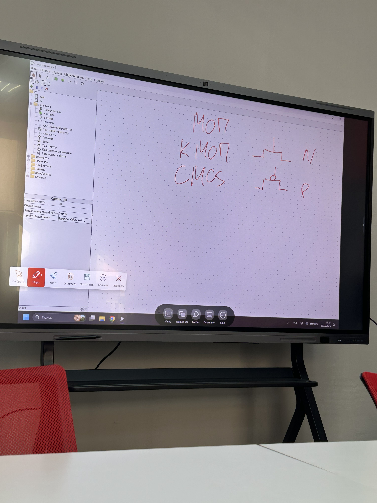
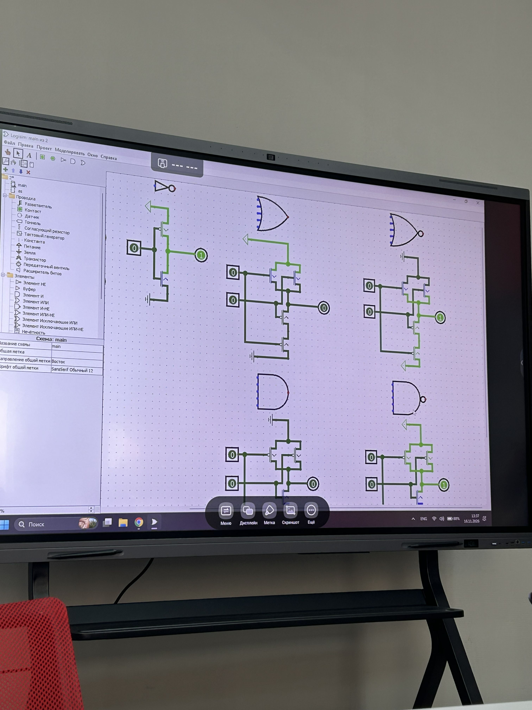

- ==1== - высокой уровень напряжения-высокий уровень(в аппаратно логических системах)   
- ==0== - низкий логический уровень - низкое напряжение(в аппаратно логических системах)  
- Разность потенциалов никогда не равна 0  
- x(неопределенность) - промежуток от 0 до 1(может быть и 0, и 1)  
- ==МОП== - полевой транзистор, только один транзистор  
- ==КМОП== - полевой транзистор, но есть p и n транзисторы. Два транзистора можно поместить в одном месте. Из этого собирается логика. Есть исток, сток и затвор(то, что открывает или закрывает от истока к стоку).  
  
- На n подали 1 - затвор открылся, подали 0 - затвор скрылся  
- На p подали 1 - затвор закрылся , подали 0 - затвор открылся.   
- ==p== тип плохо пропускает 0(большие потери). ==Работает только с 1==  
- ==n== тип плохо пропускает 1(большие потери). ==Работает только с 0==  
## *==Параллельные и последовательные соединения ==*  
Параллельные - либо открыт, либо закрыт - ИЛИ - n типы  
Последовательные -  И  
  
  
Один тип соединения - один тип транзистора!!  
++При инверсии меняем питание с землей. ++  
**==НА ЛАБЕ==**++ ++  
Смотрим на n тип - если последовательно - вентиль И  
Если параллельно- вентиль ИЛИ  
Если на входе   
Из ИЛИ-НЕ можно получить просто ИЛИ  
Из НЕ-НЕ-ИЛИ-НЕ можно получить И   
  
