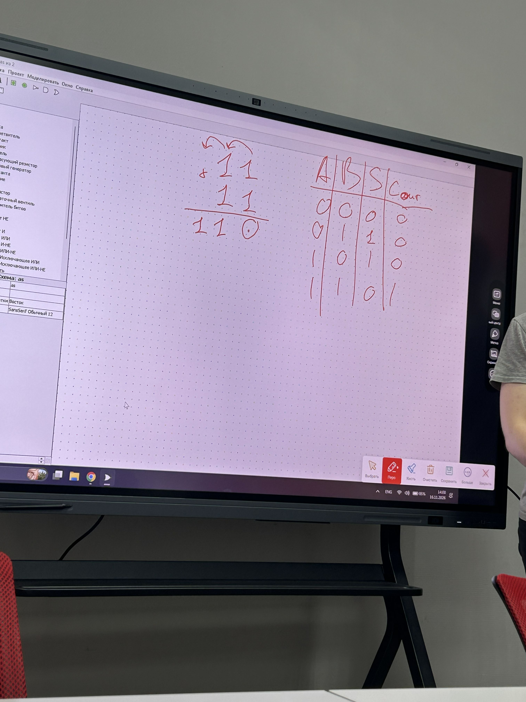
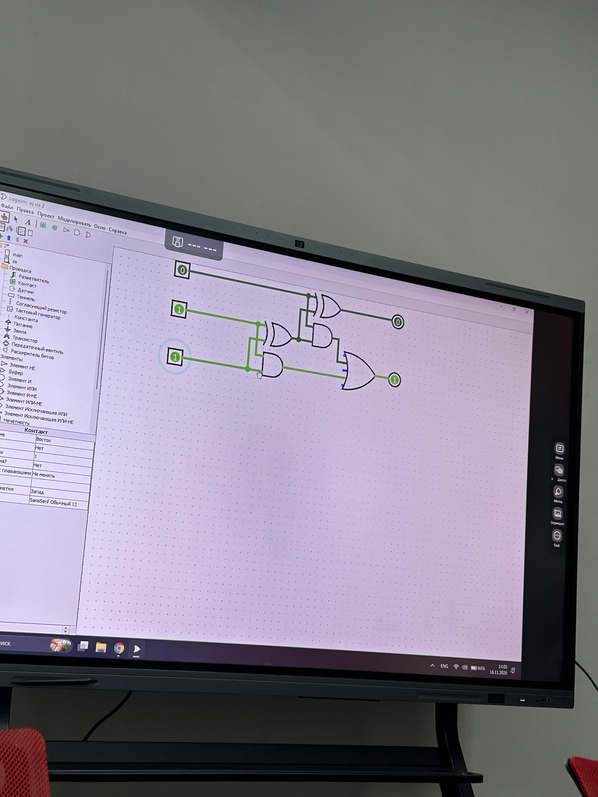
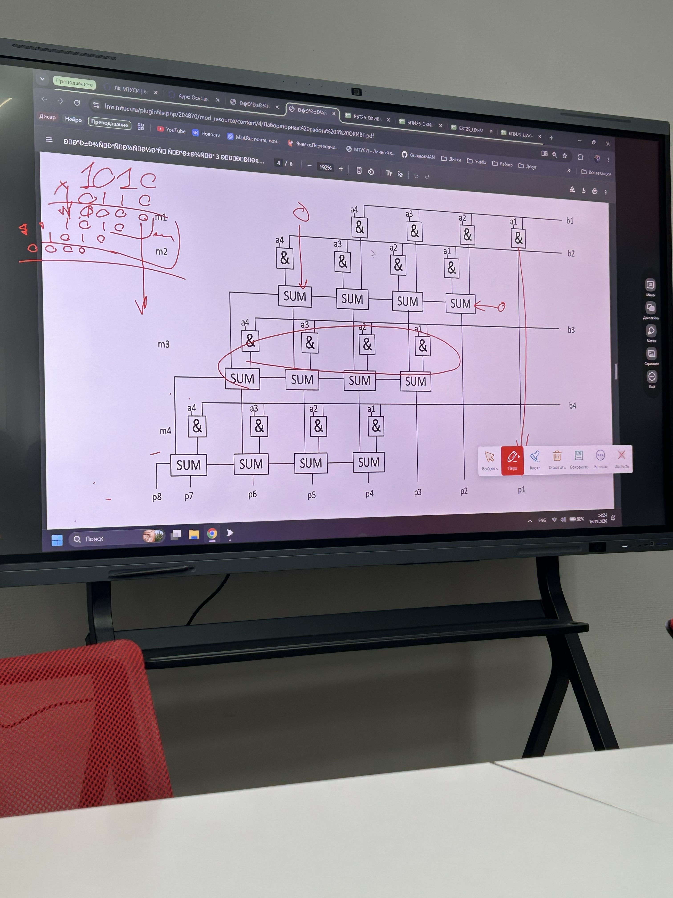
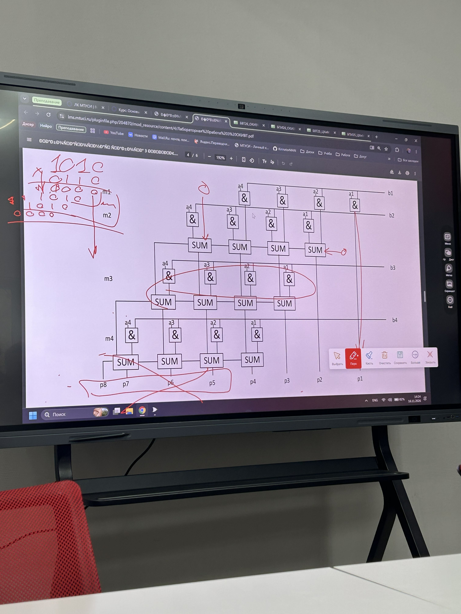

 
Есть только логические сложение, умножение и инверсия.   
Сумма S - текущий разряд   
Перенос Cout - значение при переходе в другой разряд  
  
S исключающее ИЛИ  
Cout- И   
  
- Сумматор -   
- Полусумматор - потому что есть перенос   
  
Не существует динамической памяти. Поэтому при построении 8-битного сумматора есть выход для переноса( иначе будет 9битная фигня, а из сообщения 9битной будет 10битная и тд)   
   
- Умножатор  
  
 Максимальное переполнение = входу, то есть по 4битном в ответе оставляем только последние 4  
  
