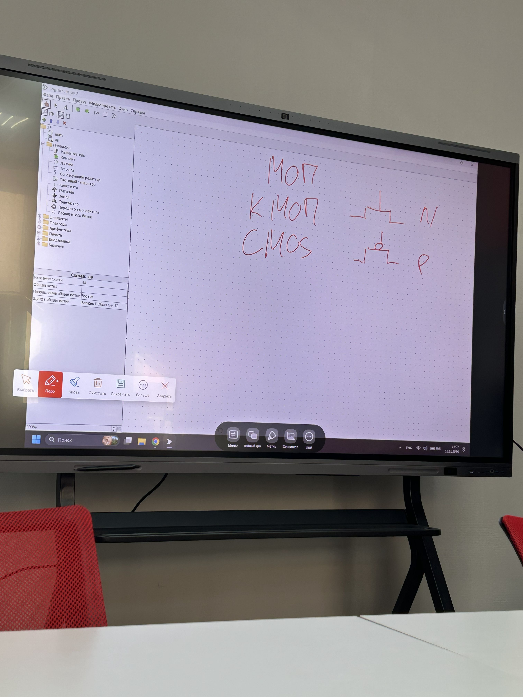
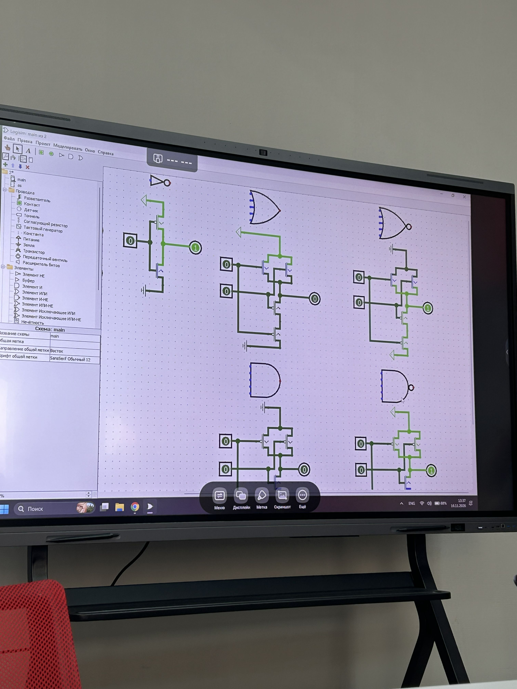
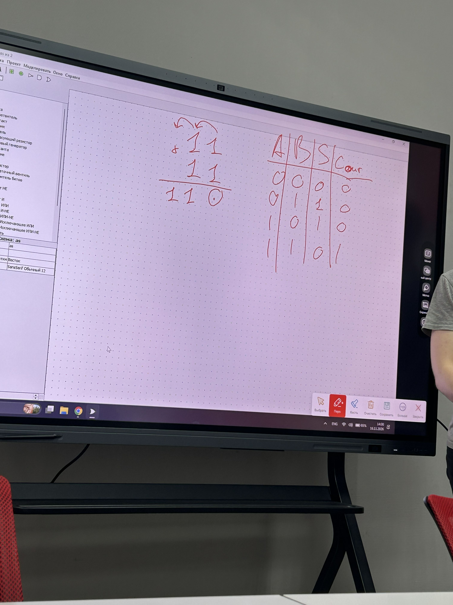
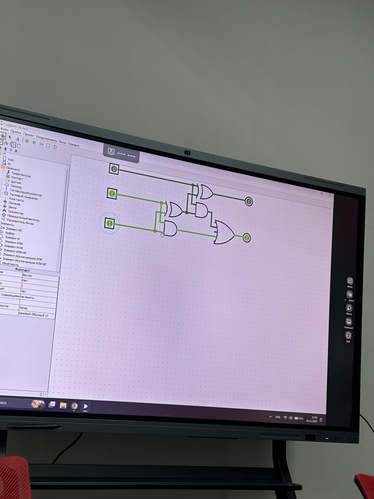
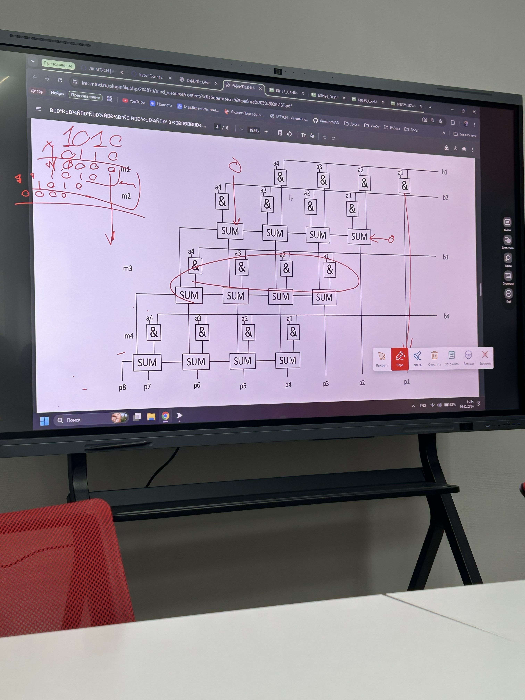
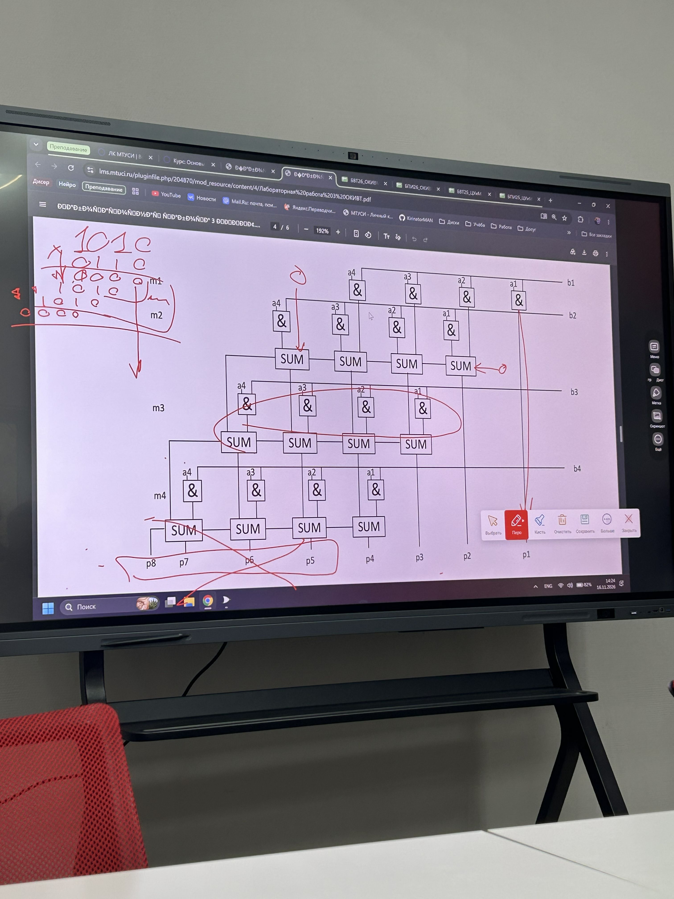

# Основы кибернетики лаба 1  
  
2 в n степени - закон комбинаторики 
Днф - форма записи формул - сложение умножений  
Кнф- умножение сложений   
Терма - скобочка с каким-то дьзъюнктом/конъюнктом  
  
Сднф/скнф- преобразование данных табличных в формулы  
  
Совершенная - та, которая полученная из таблицы истинности. Количество терм = количество функций  
  
Методы минимизации:  
- Карта Карно: минимизация данных с помощью группировки( объедение по степени 2 в квадраты, прямоугольники) ПРАВИЛА: надо как можно меньше делать квадратов, делать максимальный размер. СВОЙСТВА: карта карно- связная(крайний левый столбец соответствует крайнему правому)  
  
==Закон Де Моргана:== !(A+B) = !A*!B  
  
++Смотрим по степени 2!! ++  
Группа из 1 элемента - не сокращаем   
Группа из 2 элементов - сокращается на одну переменную  
Группа из 4 - сокращаем на две по степени двойки   
Группа из 8 переменных - сокращается на   
Вес измеряется в переменных. **==Важно не сколько сокращается, а сколько весит==**  
  
Переменные означают количество операций. Операнд - низкоуровневая переменная(то что вычисляется, число/значение)  
Операцию можем выполнять только двумя переменными   
13 переменных - 12 операций   
  
Logisim- Программа для создания логических схем(вентиль и)  
  
# Лаба 2  
- ==1== - высокой уровень напряжения-высокий уровень(в аппаратно логических системах)   
- ==0== - низкий логический уровень - низкое напряжение(в аппаратно логических системах)  
- Разность потенциалов никогда не равна 0  
- x(неопределенность) - промежуток от 0 до 1(может быть и 0, и 1)  
- ==МОП== - полевой транзистор, только один транзистор  
- ==КМОП== - полевой транзистор, но есть p и n транзисторы. Два транзистора можно поместить в одном месте. Из этого собирается логика. Есть исток, сток и затвор(то, что открывает или закрывает от истока к стоку).  
  
- На n подали 1 - затвор открылся, подали 0 - затвор скрылся  
- На p подали 1 - затвор закрылся , подали 0 - затвор открылся.   
- ==p== тип плохо пропускает 0(большие потери). ==Работает только с 1==  
- ==n== тип плохо пропускает 1(большие потери). ==Работает только с 0==  
## *==Параллельные и последовательные соединения ==*  
Параллельные - либо открыт, либо закрыт - ИЛИ - n типы  
Последовательные -  И  
  
  
Один тип соединения - один тип транзистора!!  
++При инверсии меняем питание с землей. ++  
**==НА ЛАБЕ==**++ ++  
Смотрим на n тип - если последовательно - вентиль И  
Если параллельно- вентиль ИЛИ  
Если на входе   
Из ИЛИ-НЕ можно получить просто ИЛИ  
Из НЕ-НЕ-ИЛИ-НЕ можно получить И   
  
# Лаба 3   
Есть только логические сложение, умножение и инверсия.   
Сумма S - текущий разряд   
Перенос Cout - значение при переходе в другой разряд  
  
S исключающее ИЛИ  
Cout- И   
  
- Сумматор -   
- Полусумматор - потому что есть перенос   
  
Не существует динамической памяти. Поэтому при построении 8-битного сумматора есть выход для переноса( иначе будет 9битная фигня, а из сообщения 9битной будет 10битная и тд)   
   
- Умножатор  
  
 Максимальное переполнение = входу, то есть по 4битном в ответе оставляем только последние 4  
  
